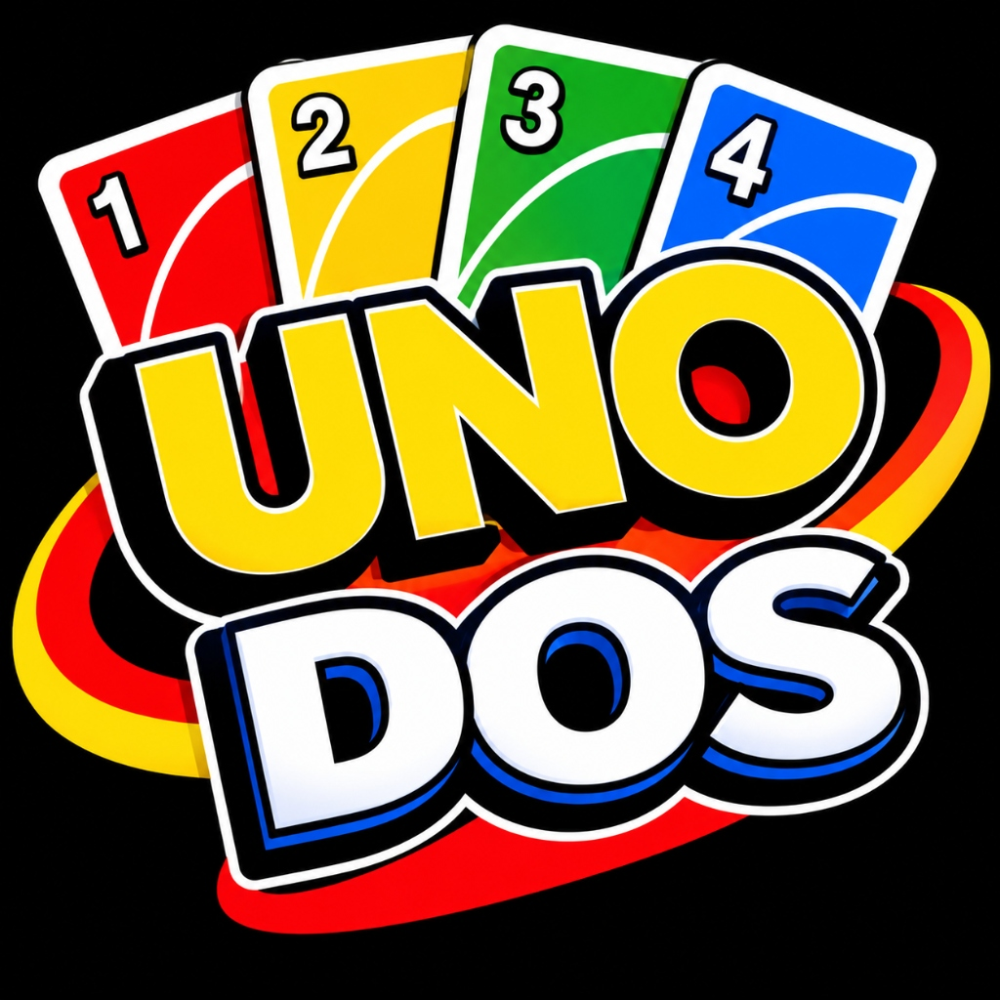

#  DOS — 1v1 Tabletop Card Arena

<p align="left">
  
  
  
  
</p>

An authentic, modern web recreation of the official **DOS** card game (the sequel to UNO), designed as an interactive 1v1 arena with intelligent bot AI, procedural Web Audio sound synthesis, a custom theme engine, and a tactile tabletop experience.

Made with ❤️ by **Antigravity** & **SohamRoy20**.

---

## 🎮 How to Play DOS

### 🎯 Objective
Be the first player to empty your hand. In **200-pt Match Mode**, the winner of each round scores points for all cards remaining in the opponent's hand until someone reaches 200 points.

### 🃏 Matching the Center Row
The Center Row starts with **2 piles**. On your turn, you can match one or multiple piles (each center card can be matched at most once per turn):
- **Single Match**: Play **1 card** from your hand matching the *number* of a Center Row card (any color).
- **Double Match**: Play **2 cards** from your hand whose numbers *add up* to the Center Row card's number (e.g. $3 + 4 = 7$).
- **If No Match Possible**: Click the **Draw Pile** to draw 1 card. You may immediately match with it if eligible, or click **End Turn**.

### ✨ Color Match Bonuses
- **Single Color Match**: If your played card also matches the center card's *color*, you earn a bonus! At the end of your turn, discard **1 extra card** from your hand into the Center Row.
- **Double Color Match**: If *both* cards in a double match share the center card's *color*, you place **1 extra card** into the Center Row **AND** your opponent draws a **+1 penalty card**!

### 🌈 Special Wild Cards
- **Wild # (Colored)**: Counts as any number ($1\text{--}10$) in its specific card color (worth 20 points). An interactive value selector allows choosing its value when placed in the Center Row.
- **Wild DOS (Multi-Color 2)**: Counts as the number **2** in *any* color, automatically triggering Color Match Bonuses! (worth 50 points).

### 🚨 Calling "DOS!"
When you are down to **2 cards** in your hand, you **must** press the glowing **DOS!** button before ending your turn. If you forget, the Bot can catch you for a **+2 card penalty**! Watch closely: if the Bot forgets to shout DOS, click **🚨 Catch Bot!** to penalize it!

---

## 🚀 Key Features

- **🤖 3-Tier Bot Intelligence**:
  - **Casual** *(Default)*: Relaxed playstyle, occasionally misses optimal double matches or forgets to call DOS.
  - **Smart**: Calculates optimal point reductions and maximizes single and double color match bonuses.
  - **Ruthless**: Aggressive minimax point-denial, forces maximum draw penalties, and catches missed DOS shouts instantly.

- **🎨 Dynamic Table Theme & Button Engine**:
  - Switch between **9 curated table backgrounds**:
    - 🌲 **Emerald Felt** *(Classic Casino Felt)*
    - 🧊 **Liquid Glass** *(Frosted Glassmorphism with fluid aurora refractions)*
    - 🌊 **Midnight Blue**
    - 🍷 **Royal Crimson**
    - 🔮 **Deep Amethyst**
    - 🎱 **Charcoal Slate**
    - 🪵 **Warm Mahogany**
    - 🐬 **Teal Ocean**
    - 🌑 **OLED Black**
  - **Custom Color Support**: Visual color picker + hex/name text box (`#0F3B2E`, `teal`, `navy`) with automatic shade derivation.
  - **Dynamic Theme-Matched Buttons**: Action buttons (`New Game`, `End Turn`, `Next Round`) automatically adopt gradients, borders, and glow shadows matching the active theme.
  - **Persistence**: Remembers your preferred background theme, difficulty, and sound settings in `localStorage`.

- **🔊 Pure Web Audio Synth**:
  - Zero external `.mp3` or `.wav` dependencies.
  - Procedurally generated sound effects for card clicks, matches, color bonuses, draws, penalties, and victory fanfares.
  - Toggle sound on/off anytime with the topbar audio control.

- **📱 Responsive & Tactile UI**:
  - Card hover animations, selection indicators, staged match undo (`↩ Undo`), and hand sorting (`⇅ Sort Hand`).
  - Fluid mobile and desktop layout with touch-friendly interaction.

---

## 📂 Project Structure

```
uno-dos-ai/
├── index.html            # Main game markup and UI layout
├── README.md             # Project documentation and rules
├── css/
│   └── styles.css        # Responsive styling, glassmorphism, animations, theme tokens
├── js/
│   └── game.js           # Core DOS game engine, Bot AI, Web Audio synth, DOM controller
└── images/
    ├── favicon.ico       # Standard browser favicon
    ├── favicon.png       # PNG favicon
    ├── icon.png          # High-resolution app & touch icon (1024x1024)
    ├── icon.jpg          # Original icon artwork
    ├── uno-dos-logo.png  # Transparent header brand logo
    └── ...               # Additional game artwork and promotional banners
```
